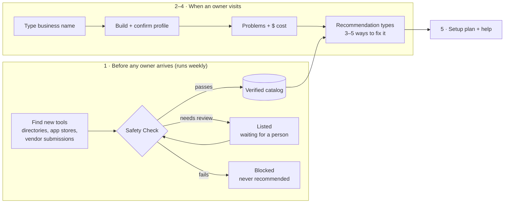

# MainStreet AI — Feature & Usability Spec

Nov 7, 2026 · v2: safety is checked when a tool enters the catalog, before any owner arrives.

## The flow at a glance

**Every tool is safety-checked before it can enter the catalog; the owner then describes their business, sees their problems, and picks from a few types of fix — all drawn only from tools that already passed.** Safety is never decided on the fly while an owner waits.

**Why this order is better:**
- **Safer:** an owner can never be shown an unchecked tool, even if the AI makes a mistake.
- **Faster and cheaper:** safety work happens once per tool, not once per visit, so results are instant and the $25 LLM budget goes much further.
- **Clearer story for judges:** "Discover → verify → catalog" is the platform; "problem → recommendation" is the owner experience.

## 1. Catalog and Safety Check (first, before any owner)

**A tool only reaches owners after it passes the Safety Check; the result is stored with the tool and re-checked on a schedule.**

### How tools enter the catalog

| # | Step | What happens | How we build it |
| --- | --- | --- | --- |
| 1.1 | **Find** | New tools come in from AI directories, app marketplaces (Square, QuickBooks, Toast, Jobber, Shopify), vendor submissions, and tools owners paste into "Check any AI tool" | Weekly job (Vercel Cron or GitHub Action) + manual "Run discovery" button for the demo |
| 1.2 | **Extract** | Pull a structured profile: what it does, which problems, industries, prices, integrations, languages, setup effort | LLM reads the vendor's site into a fixed schema; a person corrects it |
| 1.3 | **Safety Check** | Automated checks (below) produce a score and reasons | Code, not LLM opinion, wherever possible |
| 1.4 | **Human review** | A reviewer approves, edits or blocks | Admin queue |
| 1.5 | **Publish** | Tool goes into the catalog with its badge and "last checked" date | Database status change |
| 1.6 | **Re-check** | Every 30–90 days, or when pricing or the privacy policy changes | Same weekly job |

### What the Safety Check looks at

| Check | Passes when | Data source |
| --- | --- | --- |
| **Who's behind it** | Registered company, real address, named leadership | State business registries, OpenCorporates, vendor site |
| **How long it's existed** | Website domain older than 12 months | Domain age lookup (RDAP/WHOIS) |
| **Privacy policy** | Exists and is readable | Fetch + LLM summary |
| **Use of customer data** | Doesn't train AI on your data by default; you can delete it | LLM answers fixed questions from the policy, quoting the sentence |
| **Where data is stored** | Stated clearly (US preferred) | Privacy policy |
| **Pricing clarity** | Public price, monthly cancellation | Pricing page |
| **Security basics** | HTTPS; security certification if handling payments or health data | Site check + vendor claims |
| **Red flags (auto-block)** | None of: brand impersonation, no privacy policy, domain under 6 months asking for a download | Lookalike-domain check, Google Safe Browsing |

### The three badges

- **✓ Verified:** passed automatic checks and a person reviewed it. **Only Verified tools are recommended.**
- **Listed:** passed automatic checks, waiting for a person. Shown only in "browse", labelled "Not yet reviewed".
- **⚠ Blocked:** failed a check. Never recommended; shown only in "why we hid these" and when an owner checks that tool.

### What each catalog record stores (filled once, reused for every owner)

Problems it solves · industries · all-in monthly price at small, medium and large volume · works with (Square, QuickBooks, Google, Jobber…) · setup time · self-serve or needs help · languages · **plain-English privacy card** (5 answers with quoted sources) · **rules flags** (records calls? announces recording? HIPAA-ready? makes outbound AI calls? personalizes prices?) · badge · last checked date.

## 2. Onboarding: understand the business

**The owner types one thing — their business name — and we build a Business Profile from public sources, then ask them to confirm it.** A short form stays as the fallback for businesses with no online presence. Target: profile confirmed in under 90 seconds.

### What we scan automatically

| # | Feature | What the owner sees | How we build it | Why it matters |
| --- | --- | --- | --- | --- |
| 2.1 | **Business lookup** | Type a name → pick the right match from 3 results | Google Places API (Text Search + Place Details): name, address, phone, hours, category, rating, review count, website | One field replaces half the form |
| 2.2 | **Review scan** | "What your customers say" — top themes, good and bad | Places API returns at most **5 reviews per place** ([Apify docs](https://apify.com/cloud9_ai/google-reviews-scraper?fpr=97nrp4)). LLM tags themes: missed calls, slow replies, pricing, booking | Finds problems the owner may not see |
| 2.3 | **Paste more reviews (optional)** | "Paste a few more reviews for a better read" | Free-text box → same LLM tagging | Works around the 5-review limit without scraping |
| 2.4 | **Website scan** | Services, prices, hours, "book online" or not, contact form or not | Fetch homepage + linked pages; LLM extracts into a fixed schema | Feeds problems and the setup content |
| 2.5 | **Tools-you-use detection** | "Looks like you use Square Online and Google Calendar — right?" | Match page HTML against known signatures (open-source [Wappalyzer](https://github.com/eon01/Wappalyzer)-style patterns for Square, Toast, Wix, Shopify, Calendly, Jobber, etc.) | Pre-fills "current tools"; scores the rubric's legacy-tech point |
| 2.6 | **Policy scan** | "Your website has a privacy policy and a refund policy" | Find links named privacy / terms / refund; LLM summarizes into a few facts | Tells us how careful they must be with data |
| 2.7 | **Data sensitivity level** | Low / Medium / High, with why | Rules from category + policy scan: card payments, health info, children's info, legal/financial records | Narrows which tools fit |
| 2.8 | **Rules that apply to you** | "3 rules that affect which AI tools you can use" in plain English | Rules table by state + industry (below), matched against each tool's rules flags | Real-world safety for *this* business |
| 2.9 | **Location context** | County, urban or rural, nearest SBDC office | Address → county; county → Maryland SBDC region and SCORE chapter | Local help and the rural story |
| 2.10 | **Languages nearby** | "About 1 in 6 households near you speak Spanish" (example) | Census ACS language data by ZIP | Prioritizes tools that handle Spanish |
| 2.11 | **Internet check (rural)** | "Your area may have slow internet — we'll favor tools that work on a phone" | [FCC National Broadband Map](https://broadbandmap.fcc.gov/home) by address (or a county-level flag for the MVP) | Rural Maryland applicability |

### What we still ask (short, tap-to-answer)

- **Confirm the profile:** "Is this right?" with an edit on every field.
- **Team size** and **monthly AI budget** (under $50 / $50–150 / $150+).
- **Main goal:** more customers, save time, or both.
- **Tech comfort:** "I'll set it up myself" or "I need someone to help".
- **Deal-breakers:** no contracts, no call recording, must speak Spanish, must work offline.
- **One open question:** "What eats most of your week?" (free text → LLM → our use-case list).

### Rules that apply to you: first version for Maryland

Tool safety is decided in the catalog. These rules are different: a tool can be safe in general but wrong for *this* business. They filter recommendations per owner.

| Rule | Applies to | What we show the owner | How it changes recommendations |
| --- | --- | --- | --- |
| **Maryland all-party consent for recording calls** ([RCFP](https://www.rcfp.org/reporters-recording-guide/maryland/)) | Anyone using an AI receptionist that records calls | "If your AI records calls, it must tell callers at the start." | Only phone tools flagged "announces recording" |
| **Maryland Online Data Privacy Act** — applies at 35,000 Maryland consumers' data a year, with no small-business exemption ([PrivacyLawMap](https://privacylawmap.com/states/maryland)) | Businesses with big customer or loyalty lists | "If you keep data on 35,000+ Maryland customers, extra privacy rules apply." | Favors tools with data deletion and minimal collection |
| **Maryland AI Dynamic Pricing Act**, effective Oct 1, 2026 ([AI Law Wiki](https://ailawwiki.com/Maryland_AI_Dynamic_Pricing_Act)) | Food retailers and delivery services | "You can't use AI to set different prices for different customers." | Hides personalized-pricing tools |
| **FCC: AI-voice calls need consent** ([Orrick](https://www.orrick.com/insights/2024/02/Did-the-FCC-Really-Ban-AI-Generated-Voice-Calls-No-But-Restrictions-Apply)) | Anyone using AI to make outbound calls | "AI can't call customers without their permission." | Flags outbound calling tools |
| **HIPAA** (federal) | Health, dental, therapy, chiropractic | "Patient info needs a HIPAA-ready tool with a signed agreement." | Only HIPAA-ready tools |

The rules table is data, not code: adding another state means adding rows. Always show "Not legal advice — ask your SBDC advisor."

## 3. Problems found: show the evidence and the dollars

**Every problem comes with proof from the owner's own business and a dollar estimate.**

| # | Feature | What the owner sees | How it works |
| --- | --- | --- | --- |
| 3.1 | **Problem cards with evidence** | "Calls after 5pm go unanswered — 3 reviews mention *never called back*; your hours end at 5pm." | Signals from 2.2–2.6 mapped to our use-case list by rules first, LLM second; each card cites its source |
| 3.2 | **Ranked by impact** | Top 3 problems, biggest first | Number of signals × typical cost in that industry |
| 3.3 | **"Pays for itself in X days"** | "You miss ~8 calls a week × $400 jobs. This $49 tool pays for itself in 3 days." | Two numbers the owner knows (or sliders) × the tool's all-in monthly cost. Show the math; label it an estimate |
| 3.4 | **Problems they didn't know about** | "We also noticed: your Google hours say 6pm, your website says 5pm" | Cross-checks between Google and website data |
| 3.5 | **Add a problem** | "Anything else?" with tap options and free text | Covers businesses with little online presence |

## 4. Recommendation types: 3–5 ways to fix each problem

**For each problem, the owner sees a few different kinds of fix, not one ranked list.** Every option comes only from Verified tools that pass the owner's rules.

| # | Type | What the owner sees | When it shows |
| --- | --- | --- | --- |
| 4.1 | **Use what you already have** | "You already pay for Jobber — turn on its AI receptionist add-on." | When a tool they already use has an AI feature for this problem (from 2.5). Often the cheapest, fastest win, and no other platform looks for it |
| 4.2 | **Quick fix** | One tool that solves this problem, best Fit Score | Always |
| 4.3 | **Starter Kit** | 2–4 tools that work together across their top problems, total monthly cost, how they connect | When 2+ problems are found |
| 4.4 | **Lowest cost** | The cheapest Verified option, including free tiers | When the budget is tight or the cheapest differs from the Quick fix |
| 4.5 | **Done for you** | A tool plus someone to set it up: SBDC advisor, SCORE mentor, or vetted helper (prototype) | When tech comfort is "I need help" |

### How options are ranked: Fit Score (0–100)

| Part | Weight | How we measure it |
| --- | --- | --- |
| Fit with the problem | 35% | Tool's use cases vs. the owner's problem (taxonomy match, then embedding similarity) |
| Works with their current tools | 25% | Native integration = full; via Zapier = half; none = zero |
| Within budget | 20% | Full under budget; drops to zero at 1.5× budget |
| Ease of setup | 10% | Self-serve under 1 hour = full; needs a helper = low |
| Reviews | 10% | Average rating, only with enough reviews |

### On every option

| # | Feature | What it does |
| --- | --- | --- |
| 4.6 | **"Why this pick"** | One plain sentence built from the Fit Score parts, not invented by the LLM |
| 4.7 | **Safety badge + privacy card** | ✓ Verified, last-checked date, and the 5 plain-English privacy answers from the catalog |
| 4.8 | **Works-with and rules badges** | "Works with your Square" · "OK for Maryland call recording ✓" · "HIPAA-ready ✓" |
| 4.9 | **Compare** | 2–3 options side by side: cost, works with, setup time, Spanish, safety |
| 4.10 | **"Why not these?"** | Blocked or rule-failing tools we left out, with one-line reasons |
| 4.11 | **Check any AI tool** | Paste a link from an ad; see its catalog badge, or run the Safety Check now if it's new (it then joins the review queue) |

## 5. Setup and adoption: get it running, not just chosen

**Every recommendation ends with a plan the owner can follow and a human they can call.**

| # | Feature | What it does |
| --- | --- | --- |
| 5.1 | **30-day setup plan** | Week-by-week steps with time per step ("Day 3: forward after-hours calls — 10 min") |
| 5.2 | **Pre-written content** | From the Business Profile: receptionist greeting, FAQ answers, 3 review-reply templates. Copy with one tap |
| 5.3 | **Get help** | Nearest Maryland SBDC office and SCORE mentor by county; vetted-helper listing (labelled "prototype") |
| 5.4 | **Send my plan to my SBDC advisor** | Share link or printable page an advisor can open before meeting the owner |
| 5.5 | **Print / email my plan** | One-page printable plan; "email it to me" |
| 5.6 | **Spanish toggle** | Key screens and the plan in Spanish |
| 5.7 | **Free money and help** | SBA resources, SBDC workshops, county programs that fit this business |
| 5.8 | **Day-7 and day-30 check-in** (16-week plan) | "Still using it? Did it help?" Answers feed back into the catalog over time — our answer to "why can't OpenAI do this" |

## 6. Usability metrics: what we measure and the target

**Pick 6–8 of these, measure them Saturday night with 5 non-technical testers, and put the results in the video.**

### Measure this weekend

| Metric | Target | How to measure |
| --- | --- | --- |
| **Time to first recommendation** | Under 3 minutes | Stopwatch from "type business name" to recommendations |
| **Task success rate** | 4 of 5 testers complete each task alone | 3 tasks: find a safe tool for missed calls; compare two options; get the setup plan |
| **System Usability Scale (SUS)** | 75+ (industry average is about 68) | Standard 10-question survey after the tasks |
| **"How hard was that?" (1–7)** | 6+ average | One question after each task |
| **Taps to recommendations** | 8 or fewer | Count in the golden path |
| **Profile accuracy** | Owner edits 1 field or fewer | Count edits on "Is this right?", using 5 real local businesses |
| **Trust understanding** | 4 of 5 testers can say *why* a tool is safe | Ask: "Why can you trust this one?" |
| **Reading level** | Grade 8 or lower | Hemingway or Flesch-Kincaid on all screen text |
| **Accessibility** | 0 critical issues; WCAG 2.2 AA contrast; tap targets 44px+ | axe DevTools + Lighthouse |
| **Speed on a slow phone** | Lighthouse mobile performance 85+; page under 1 MB | Lighthouse with slow-4G throttling |
| **Catalog safety** | 0 Blocked or Listed tools ever recommended | Seed 3 scam-style tools; run 10 owner profiles; confirm none appear |
| **Works without AI** | Recommendations still appear with the LLM key off | Disable the key and run the golden path |

### Track after launch (16-week plan)

- **Catalog health:** % of tools re-checked on time; time from "found" to "Verified".
- **Plan start rate:** % of owners who start the setup plan.
- **Adoption:** % still using a recommended tool at day 30 and day 90.
- **Recommendation type mix:** how often owners pick "use what you have" vs. new tools vs. done-for-you.
- **Safety:** reports of a problem with a recommended tool (target: zero).

## 7. What to build first, by person

**Person B starts the catalog and Safety Check first, because everything downstream reads from it.** A and C build against mock catalog data until it lands.

| Priority | Person A — Engine | Person B — Data & Trust | Person C — Experience |
| --- | --- | --- | --- |
| **Must** | 2.1 lookup · 2.2 + 2.3 reviews · 2.4 website scan · fallback form · 3.1 problem cards · 3.3 pays-for-itself · Fit Score · 4.2 Quick fix · 4.3 Starter Kit | Catalog of 60–80 tools with all record fields · Safety Check (1.3) + badges · privacy cards · rules flags · discovery admin (1.1–1.5) · 2.8 rules table (5 Maryland rows) | Screens: profile confirm, problems, recommendation types, tool detail, compare, plan · 5.1 + 5.2 · 5.3 get help · 5.5 print · tester session |
| **Should** | 4.1 use what you have (needs 2.5) · 2.5 tools-you-use detection · 4.4 lowest cost | 4.11 check any AI tool · 4.10 why-not list · 2.9 county → SBDC/SCORE | 4.5 done for you · 5.4 send to SBDC advisor |
| **Could** | 3.4 Google-vs-website mismatches · 2.10 languages nearby | 2.7 data sensitivity · 2.11 internet check · 1.6 scheduled re-checks | 5.6 Spanish toggle |
| **16-week plan only** | Learning from day-30 outcomes | Rules for more states · vendor watch | 5.8 check-ins · real helper marketplace |

### Guardrails

- **Only Verified tools are recommended.** Listed and Blocked tools never appear as options.
- **Use only public information** about the owner, and always let them confirm or correct it.
- **Use official APIs, not scrapers,** for Google data. On websites, read only public pages and respect robots.txt.
- **Cache every lookup and LLM call** so the demo never breaks and the $25 key lasts.
- **Label honestly:** estimates as estimates, sample data as sample, rules as "Not legal advice — ask your SBDC advisor."
- **Store nothing sensitive** about owners or their customers.

## Sources

- [Apify: Google Places API returns at most 5 reviews per place](https://apify.com/cloud9_ai/google-reviews-scraper?fpr=97nrp4)
- [Wappalyzer (open source): detects the technologies a website uses](https://github.com/eon01/Wappalyzer)
- [RCFP: Maryland Wiretap Act, all-party consent](https://www.rcfp.org/reporters-recording-guide/maryland/)
- [PrivacyLawMap: Maryland Online Data Privacy Act thresholds](https://privacylawmap.com/states/maryland)
- [AI Law Wiki: Maryland AI Dynamic Pricing Act](https://ailawwiki.com/Maryland_AI_Dynamic_Pricing_Act)
- [Orrick: FCC ruling on AI-generated voice calls](https://www.orrick.com/insights/2024/02/Did-the-FCC-Really-Ban-AI-Generated-Voice-Calls-No-But-Restrictions-Apply)
- [FCC National Broadband Map](https://broadbandmap.fcc.gov/home)
- Team plan: [`docs/HANDOFF_PROMPT.md`](HANDOFF_PROMPT.md)
