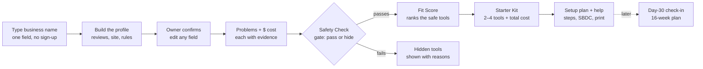

# MainStreet AI — Feature & Usability Spec

Nov 7, 2026 · Live version (with comments): https://claude.ai/artifact/KShDPi1f7VS7ihXKxaBFXv

## The flow at a glance

**MainStreet AI understands the business before it recommends anything, and safety is checked before fit.** The owner types one thing; we do the research; they confirm; then they get a short, safe Starter Kit and a plan to set it up.

Unsafe tools never reach the Fit Score; they appear only in a "why we hid these" list. Day-30 check-ins are in the 16-week plan, and later feed real outcomes back into the scores.

## 1. Onboarding: understand the business before recommending anything

**The owner types one thing — their business name — and we build a Business Profile from public sources, then ask them to confirm it.** A short form stays as the fallback for businesses with no online presence. Target: profile confirmed in under 90 seconds.

### What we scan automatically

| # | Feature | What the owner sees | How we build it | Why it matters |
| --- | --- | --- | --- | --- |
| 1.1 | **Business lookup** | Type a name → pick the right match from 3 results | Google Places API (Text Search + Place Details): name, address, phone, hours, category, rating, review count, website | One field replaces half the form |
| 1.2 | **Review scan** | "What your customers say" — top themes, good and bad | Places API returns at most **5 reviews per place** ([Apify docs](https://apify.com/cloud9_ai/google-reviews-scraper?fpr=97nrp4)). LLM tags themes: missed calls, slow replies, pricing, booking | Finds problems the owner may not see |
| 1.3 | **Paste more reviews (optional)** | "Paste a few more reviews for a better read" | Free-text box → same LLM tagging | Works around the 5-review limit without scraping |
| 1.4 | **Website scan** | Services, prices, hours, "book online" or not, contact form or not | Fetch homepage + linked pages; LLM extracts into a fixed schema | Feeds problems and the fact-check |
| 1.5 | **Tools-you-use detection** | "Looks like you use Square Online and Google Calendar — right?" | Match page HTML against known signatures (open-source [Wappalyzer](https://github.com/eon01/Wappalyzer)-style patterns for Square, Toast, Wix, Shopify, Calendly, Jobber, etc.) | Pre-fills "current tools"; directly scores the rubric's legacy-tech point |
| 1.6 | **Policy scan** | "Your website has a privacy policy and a refund policy" | Find links named privacy / terms / refund; LLM summarizes into a few facts | Tells us how careful they must be with data |
| 1.7 | **Data sensitivity level** | Low / Medium / High, with why | Rules from category + policy scan: takes card payments, health info, children's info, legal/financial records | Filters tools (e.g. health businesses need HIPAA-ready tools) |
| 1.8 | **Rules check** | "3 rules that affect which AI tools you can use" in plain English | Rules table by state + industry (below) | No other team will have this; it's real safety |
| 1.9 | **Location context** | County, urban or rural, nearest SBDC office | Address → county lookup; county → Maryland SBDC region and SCORE chapter | Local help and the rural story |
| 1.10 | **Languages nearby** | "About 1 in 6 households near you speak Spanish" (example) | Census ACS language data by ZIP | Prioritizes tools that handle Spanish callers |
| 1.11 | **Internet check (rural)** | "Your area may have slow internet — we'll favor tools that work on a phone" | [FCC National Broadband Map](https://broadbandmap.fcc.gov/home) lookup by address (or a county-level flag for the MVP) | Rural Maryland applicability |

### What we still ask (short, tap-to-answer)

- **Confirm the profile:** "Is this right?" with an edit on every field.
- **Team size** and **monthly AI budget** (under $50 / $50–150 / $150+).
- **Main goal:** more customers, save time, or both.
- **Tech comfort:** "I'll set it up myself" or "I need someone to help".
- **Deal-breakers:** no contracts, no call recording, must speak Spanish, must work offline.
- **One open question:** "What eats most of your week?" (free text → LLM → our use-case list).

### The rules check: first version for Maryland

| Rule | Applies to | What we show the owner | How it changes recommendations |
| --- | --- | --- | --- |
| **Maryland all-party consent for recording calls** ([RCFP](https://www.rcfp.org/reporters-recording-guide/maryland/)) | Anyone using an AI receptionist that records calls | "If your AI records calls, it must tell callers at the start." | Badge on phone tools: "Announces recording ✓" or a warning |
| **Maryland Online Data Privacy Act** — applies at 35,000 Maryland consumers' data a year, with no small-business exemption ([PrivacyLawMap](https://privacylawmap.com/states/maryland)) | Businesses with big customer or loyalty lists | "If you keep data on 35,000+ Maryland customers, extra privacy rules apply." | Favors tools with data-deletion and minimal data collection |
| **Maryland AI Dynamic Pricing Act**, effective Oct 1, 2026 ([AI Law Wiki](https://ailawwiki.com/Maryland_AI_Dynamic_Pricing_Act)) | Food retailers and delivery services | "You can't use AI to set different prices for different customers." | Hides personalized-pricing tools for groceries and delivery |
| **FCC: AI-voice calls need consent** ([Orrick](https://www.orrick.com/insights/2024/02/Did-the-FCC-Really-Ban-AI-Generated-Voice-Calls-No-But-Restrictions-Apply)) | Anyone using AI to make outbound calls | "AI can't call customers without their permission." | Flags outbound calling tools |
| **HIPAA** (federal) | Health, dental, therapy, chiropractic | "Patient info needs a HIPAA-ready tool with a signed agreement." | Only HIPAA-ready tools for these businesses |

The rules table is data, not code: adding another state means adding rows. Always show "Not legal advice — ask your SBDC advisor" under it.

## 2. Problems found: show the evidence and the dollars

**Every problem we show comes with proof from the owner's own business and a dollar estimate.** That's what turns "AI tools" into "money you're losing".

| # | Feature | What the owner sees | How it works |
| --- | --- | --- | --- |
| 2.1 | **Problem cards with evidence** | "Calls after 5pm go unanswered — 3 reviews mention *never called back*; your hours end at 5pm." | Signals from 1.2–1.6 mapped to our use-case list by rules first, LLM second; each card cites its source |
| 2.2 | **Ranked by impact** | Top 3 problems, biggest first | Score = how many signals point to it × how much it usually costs that industry |
| 2.3 | **"Pays for itself in X days"** | "You miss ~8 calls a week × $400 jobs. This $49 tool pays for itself in 3 days." | Two numbers the owner knows (or sliders) × the tool's real monthly cost. Show the math; label it an estimate |
| 2.4 | **Problems they didn't know about** | A "We also noticed" card: "Your Google hours say 6pm, your website says 5pm" | Simple cross-checks between Google and website data |
| 2.5 | **Add a problem** | "Anything else?" with tap options and free text | Covers businesses with little online presence |

## 3. Recommendations: safe first, then best fit

**Model B: a Safety Check decides whether a tool can be recommended at all; a Fit Score then ranks the safe tools for this owner.** Safety is a gate, not a number to trade off against price.

### Step 1 — Safety Check (the gate)

- **Checks:** vendor identity (registered company, address, years operating, domain age), privacy policy exists and what it says, how they use customer data (do they train AI on it?), pricing clarity.
- **Result:** **Verified**, **Listed** (found automatically, not yet reviewed) or **⚠ Use caution**. Caution tools are never recommended.
- **Rules-fit:** the Rules Check (1.8) also removes tools that would break a rule for this business, like a call-recording tool that doesn't announce recording in Maryland.

### Step 2 — Fit Score (0–100, ranks the safe tools)

| Part | Weight | How we measure it |
| --- | --- | --- |
| Fit with the problem | 35% | Tool's use cases vs. the owner's top problems (taxonomy match, then embedding similarity) |
| Works with their current tools | 25% | Native integration = full points; via Zapier = half; none = zero |
| Within budget | 20% | Full points under budget; drops to zero at 1.5× budget |
| Ease of setup | 10% | Self-serve under 1 hour = full; needs a helper = low |
| Reviews | 10% | Average rating, only from tools with enough reviews |

### What the owner sees

| # | Feature | What it does |
| --- | --- | --- |
| 3.1 | **AI Starter Kit** | 2–4 tools, one per problem, with the **total monthly cost** and how they connect ("Receptionist books into your Google Calendar") |
| 3.2 | **"Why this pick"** | One plain sentence per tool, built from the Fit Score parts, not invented by the LLM |
| 3.3 | **Works-with badges** | "Works with your Square" — personalized from 1.5 |
| 3.4 | **Plain-English privacy card** | AI reads the vendor's privacy policy and answers 5 questions: trains on your data? where is it stored? can you delete it? cancel anytime? who owns the company? Each answer links to the sentence it came from |
| 3.5 | **Rules badges** | "OK for Maryland call recording ✓" / "HIPAA-ready ✓" |
| 3.6 | **Compare** | 2–3 tools side by side in plain words: cost, safety, works with, setup time, Spanish |
| 3.7 | **"Why not these?"** | A short list of tools we hid and why ("website 3 months old, no privacy policy") — builds trust in the picks |
| 3.8 | **Check any AI tool** | Paste a link from an ad; run the same Safety Check live; Safe / Caution / Avoid with reasons. Unknown tools join the discovery queue |

## 4. Setup and adoption: get it running, not just chosen

**Every recommendation ends with a plan the owner can actually follow, and a human they can call.** Most platforms stop at "Visit website".

| # | Feature | What it does |
| --- | --- | --- |
| 4.1 | **30-day setup plan** | Week-by-week steps for the chosen Starter Kit, with time per step ("Day 3: forward after-hours calls — 10 min") |
| 4.2 | **Pre-written content** | Generated from the Business Profile: the AI receptionist greeting, FAQ answers, 3 review-reply templates. Copy with one tap |
| 4.3 | **Get help** | Nearest Maryland SBDC office and SCORE mentor by county; a vetted-helper listing (labelled "prototype") |
| 4.4 | **Send my plan to my SBDC advisor** | A share link or printable page an advisor can open before meeting the owner |
| 4.5 | **Print / email my plan** | One-page printable plan; "email it to me" |
| 4.6 | **Spanish toggle** | Key screens and the plan in Spanish |
| 4.7 | **Free money and help** | SBA resources, SBDC workshops, county programs that fit this business |
| 4.8 | **Day-7 and day-30 check-in** (16-week plan) | "Still using it? Did it help?" Answers feed the Trust Score over time — our answer to "why can't OpenAI do this" |

## 5. Usability metrics: what we measure and the target

**Pick 6–8 of these, measure them Saturday night with 5 non-technical testers (family, friends, a local shop), and put the results in the video.** Real numbers from real testers earn research and UX points.

### Measure this weekend

| Metric | Target | How to measure |
| --- | --- | --- |
| **Time to first recommendation** | Under 3 minutes | Stopwatch from "type business name" to Starter Kit |
| **Task success rate** | 4 of 5 testers complete each task alone | 3 tasks: find a safe tool for missed calls; compare two tools; get the setup plan |
| **System Usability Scale (SUS)** | 75+ (industry average is about 68) | Standard 10-question survey after the tasks |
| **"How hard was that?" (1–7)** | 6+ average | One question after each task |
| **Taps to Starter Kit** | 8 or fewer | Count in the golden path |
| **Profile accuracy** | Owner edits 1 field or fewer | Count edits on the "Is this right?" screen, using 5 real local businesses |
| **Trust understanding** | 4 of 5 testers can say *why* a tool is safe | Ask: "Why did we recommend this one?" |
| **Reading level** | Grade 8 or lower | Run all screen text through a readability checker (Hemingway, or Flesch-Kincaid) |
| **Accessibility** | 0 critical issues; WCAG 2.2 AA contrast; tap targets 44px+ | axe DevTools + Lighthouse accessibility |
| **Speed on a slow phone** | Lighthouse mobile performance 85+; page under 1 MB | Lighthouse with slow-4G throttling |
| **Safety catch rate** | 100% of planted "bad" tools flagged | Seed 3 scam-style tools; confirm none are ever recommended |
| **LLM fallback works** | App still gives a kit with AI turned off | Disable the key and run the golden path |

### Track after launch (16-week plan)

- **Plan start rate:** % of owners who start the setup plan.
- **Adoption:** % still using a recommended tool at day 30 and day 90.
- **Helper hand-off:** % who ask for SBDC or helper support, and how many get set up.
- **Estimate accuracy:** "pays for itself" estimate vs. what owners report at day 30.
- **Safety:** reports of a problem with a recommended tool (target: zero).

## 6. What to build first, by person

**Build the Must list by the Sunday 2pm feature freeze; everything else is a bonus or goes in the 16-week plan.** Feature numbers refer to the tables above.

| Priority | Person A — Engine | Person B — Data & Trust | Person C — Experience |
| --- | --- | --- | --- |
| **Must** | 1.1 business lookup · 1.2 + 1.3 reviews · 1.4 website scan · short fallback form · 2.1 problem cards · 2.3 pays-for-itself · Fit Score + 3.1–3.3 Starter Kit | Tool catalog · Safety Check gate + badges · 3.4 privacy card · 1.8 rules check (5 Maryland rows) · discovery admin | Screens: profile confirm, problems, kit, tool detail, compare, plan · 4.1 + 4.2 plan and pre-written content · 4.3 get help · 4.5 print · run the tester session |
| **Should** | 1.5 tools-you-use detection | 3.8 check any AI tool · 3.7 why-not list · 1.9 county → SBDC/SCORE data | 4.4 send to SBDC advisor |
| **Could** | 2.4 Google-vs-website mismatches · 1.10 languages nearby | 1.7 data sensitivity level · 1.11 internet check | 4.6 Spanish toggle |
| **16-week plan only** | Learning from day-30 outcomes | Rules for more states · vendor watch (price and terms changes) | 4.8 check-ins · real helper marketplace |

### Guardrails

- **Use only public information**, and always let the owner confirm or correct it.
- **Use official APIs, not scrapers**, for Google data (Places API). On business websites, read only public pages and respect robots.txt.
- **Cache every lookup and LLM call** so the demo never breaks and the $25 key lasts.
- **Label everything honestly:** estimates as estimates, sample data as sample, and the rules check as "Not legal advice — ask your SBDC advisor."
- **Store nothing sensitive.** No customer data, no payment info, no logins.

## Sources

- [Apify: Google Places API returns at most 5 reviews per place](https://apify.com/cloud9_ai/google-reviews-scraper?fpr=97nrp4)
- [Wappalyzer (open source): detects the technologies a website uses](https://github.com/eon01/Wappalyzer)
- [RCFP: Maryland Wiretap Act, all-party consent](https://www.rcfp.org/reporters-recording-guide/maryland/)
- [PrivacyLawMap: Maryland Online Data Privacy Act thresholds](https://privacylawmap.com/states/maryland)
- [AI Law Wiki: Maryland AI Dynamic Pricing Act](https://ailawwiki.com/Maryland_AI_Dynamic_Pricing_Act)
- [Orrick: FCC ruling on AI-generated voice calls](https://www.orrick.com/insights/2024/02/Did-the-FCC-Really-Ban-AI-Generated-Voice-Calls-No-But-Restrictions-Apply)
- [FCC National Broadband Map](https://broadbandmap.fcc.gov/home)
- Team plan: [`docs/HANDOFF_PROMPT.md`](HANDOFF_PROMPT.md)
